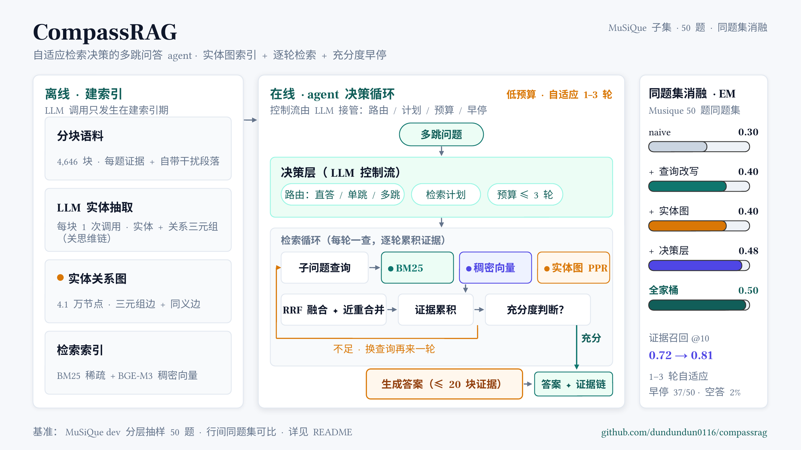

# CompassRAG

> Adaptive Retrieval Decisions over Structured Indexes for Multi-Hop QA



面向多跳问答的 **agentic RAG**：主体是一个以**检索决策**为核心循环的 LLM agent——要不要查、怎么查、查几轮、何时收手。查询改写融合、实体图索引是它逐级点亮的能力组件；公开基准上的**同题集消融阶梯**量化每一项能力的贡献，而不是并列堆砌。

- **检索决策层**：LLM 接管控制流——问题路由（直答 / 单跳 / 多跳）、子问题计划、逐轮检索、证据充分度早停、预算上限。实测 50 题中 37 题提前收手，自适应 1-3 轮。
- **实体图索引**（HippoRAG 式）：逐块用 LLM 抽取实体与关系三元组，构建跨文档实体图（同义边消歧），查询时以查询实体为种子跑 Personalized PageRank——用图上游走单步完成"多跳联想"，作为与 BM25 / 稠密向量**等权互补**的第三路检索信号。
- **查询改写融合**：多跳分解 + HyDE 假答案改写 + 多路 RRF 融合与近重合并。

## 结果一览

**同题集消融阶梯**（MuSiQue dev 分层抽样 50 题；行间严格同题集可比，绝对数字随语料规模变化）：

| 配置 | EM | F1 | 证据召回@10 | token/题 |
|---|---|---|---|---|
| naive（单轮固定检索） | 0.300 | 0.422 | 0.720 | 3,927 |
| + 查询改写融合 | 0.400 | 0.553 | 0.720 | 4,541 |
| + 实体图索引 | 0.400 | 0.544 | **0.813** | **3,346** |
| + 检索决策层 | 0.480 | **0.662** | 0.537\* | 16,071 |
| **全家桶（三者全开）** | **0.500** | 0.621 | 0.538\* | 14,682 |

\* 决策行证据为逐轮累积，@10 只统计第一轮，名义值偏低；全表原始口径，非空口径（43 题）全家桶 EM/F1 = 0.535 / 0.676。

几个值得单看的数字：

- **决策层的成本叙事**：自适应 1-3 轮 + 充分度早停（37/50 提前收手），比 naive 高 **+18pp EM**（0.300→0.480）；代价是约 4 倍 token。
- **实体图在检索层**：三路等权融合把"两跳证据全捞到"的比例（full_hit@20）从 0.487 提到 **0.620（+27% 相对）**，且单路就比两路混合强（0.503 vs 0.487）；纯图检索还**最省 token**。
- **机制分工**：查询改写不改证据召回（0.720→0.720），提升的是"给定证据的作答质量"；实体图提升的是"证据覆盖"（+9.3pp）——两者正交，这是消融拆开才看得见的结论。
- **负结果留档**：最初实现的 wiki 式分层摘要索引，在加权融合 / 条目先验重排 / 准入制补捞三种修订试尽后仍无净增益，oracle 上限实验证明其检索层天花板仅 +0.8pp——随即切换到实体图路线。完整实验记录在 [PROJECT.md](PROJECT.md)。

## 快速开始 Quickstart

```bash
# 1. Setup（Python ≥ 3.10）
python -m venv .venv && source .venv/bin/activate
pip install -e ".[dense]"          # dense extra = 本地 BGE-M3 稠密检索
cp .env.example .env               # 填入任意 OpenAI 兼容端点：LLM_BASE_URL / LLM_API_KEY / LLM_MODEL

# 2. 验证 LLM 通道
python scripts/smoke_llm.py

# 3. 建语料与索引（musique 抽样题小库：4,646 块；原始数据首次运行自动下载）
python scripts/build_corpus.py --benchmarks musique --from-samples
python scripts/embed_corpus.py --benchmarks musique --variant samples   # 本地向量化（无 API）
python scripts/build_kg.py --extract --variant samples                  # LLM 实体抽取（唯一的大额步骤：约 4.6k 次调用 · ~220 万 token）
python scripts/build_kg.py --finalize --variant samples                 # 本地建图（无 API）
python scripts/ner_queries.py --benchmarks musique --variant samples    # 查询侧 NER 缓存

# 4. 评测
# 检索层（纯本地，零 API）
python scripts/eval_retrieval.py --benchmarks musique --variant samples --modes hybrid,kg,hybrid_kg
# 端到端 QA（configs/ablation/ 下逐级消融开关）
python scripts/eval_qa.py --benchmarks musique --variant samples \
    --config configs/ablation/plus_full.yaml --limit 50
```

复现实验小贴士：所有批量脚本都带**断点续跑**（按 id / 块 id 增量落盘，中断后原命令重跑即可）；`--variant samples` 表示"抽样题小库"，不带则用全量 dev 语料库；`configs/ablation/` 每个文件就是一个消融级别。

## 项目结构

```
compassrag/
├── compassrag/
│   ├── agent.py          # agent 主循环：scripted 固定流程 / LLM 决策流程两种形态
│   ├── decision/         # 决策层：路由与计划（planner）+ 充分度早停（sufficiency）
│   ├── query/            # 查询侧：多跳分解 + HyDE 改写
│   ├── index/            # 索引：实体关系图（kg.py，含 PPR）+ wiki 摘要索引（负结果留档）
│   ├── retrieval/        # BM25 / BGE-M3 稠密 / RRF 融合与近重合并
│   ├── corpus/           # 基准接入、分层抽样、分块
│   ├── eval/             # EM / F1 / 证据召回指标 + 断点续跑评测骨架
│   └── llm/              # openai 兼容客户端 + 逐调用 token 遥测
├── configs/
│   ├── models.yaml       # 端点与请求参数
│   └── ablation/         # naive / plus_rewrite / plus_kg / plus_decision / plus_full
├── scripts/              # 语料构建 / 向量化 / 建图 / NER / 检索评测 / QA 评测 / 冒烟
├── data/samples/         # 三基准 300 题分层抽样清单（seed=42，入仓可复现）
├── docs/assets/          # 架构图（.pptx 可编辑源 + 渲染 PNG）
└── tests/                # 单测套件（116 项）
```

## 现状与路线图

- ✅ 已完成：三基准接入与分层抽样；BM25 + BGE-M3 混合检索；实体图索引（建图 / PPR 检索 / 接入 agent）；查询改写融合；检索决策层（路由 / 计划 / 早停 / 预算 / 成本遥测）；同题集消融阶梯五级出数。
- 🚧 进行中：README 与文档打磨；答案生成的冗长问题（F1 口径）统一处理。
- 📌 路线图：MultiHop-RAG（含 null query 的拒答检测）与 FRAMES（三轴 LLM-judge）基准接入；CLI / Streamlit 交互 demo（决策过程时间线）；扩题到 100 题的正式全量表。

**已知局限**：消融数字来自单一基准（MuSiQue）的 50 题子集；实体抽取依赖 LLM（建索引成本随语料线性增长）；决策行的证据召回按逐轮累积计量，与单轮行的 @k 口径不完全对齐（表中已标注）。

## 方法参照

本项目的机制设计受益于以下工作，均只借鉴思路、未复用代码：

- **实体图 + PageRank 检索**：[HippoRAG](https://arxiv.org/abs/2405.14831)（NeurIPS 2024）/ [HippoRAG 2](https://arxiv.org/abs/2502.14802)（ICML 2025）——本项目的实体图索引即此形态的独立实现（含关闭思维链的抽取协议与同义边消歧细节）。
- **索引层设计空间**：[SiReRAG](https://arxiv.org/abs/2412.06206)（ICLR 2025，"相似性 vs 关联性"二分）、[RAPTOR](https://arxiv.org/abs/2401.18059)（ICLR 2024，递归摘要树）。
- **规模与方法对照**：[BM25 Wins at Scale](https://arxiv.org/abs/2607.26497)、[RAG vs. GraphRAG 系统评测](https://arxiv.org/abs/2502.11371)。
- **查询侧**：HyDE / RAG-Fusion / [Adaptive-RAG](https://arxiv.org/abs/2403.14403)（NAACL 2024，难度路由参照）。

基准数据：[MuSiQue](https://github.com/StonyBrookNLP/musique)、HotpotQA、2WikiMultiHopQA（均使用官方 dev 划分，distractor 设定）。

## License

[MIT](LICENSE)
