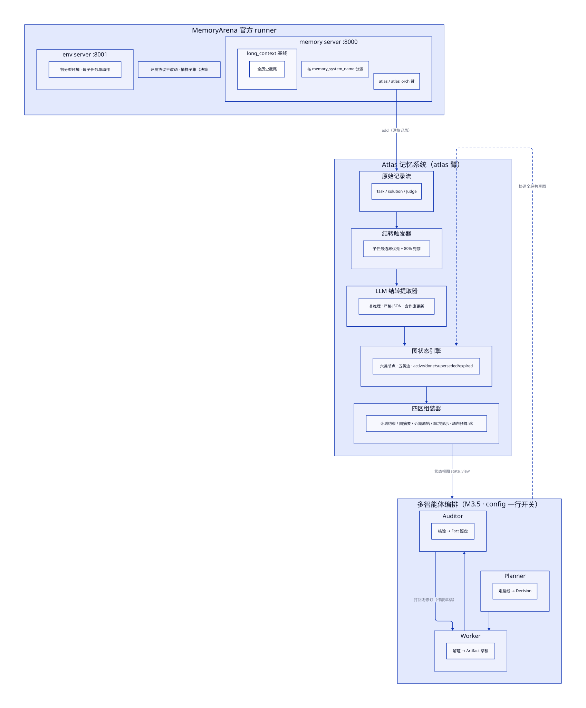

# Atlas

面向 long-horizon 任务的多智能体系统：**带时效的图状态记忆**承载执行状态，**结转式上下文管理**衔接状态层与模型上下文，**多智能体围绕共享状态图协作**，并在 [MemoryArena](https://arxiv.org/abs/2602.16313) 上量化验证。

> Long-horizon agents forget. Text compression drops structure and exact values; semantic retrieval fragments decision chains. Atlas keeps execution state in a time-aware graph, carries it over into the model context, and lets multiple roles coordinate through that single shared graph.



## 问题

长任务必然超出上下文窗口，历史必须压缩；压缩丢状态 → agent 违反早期约束、重复犯已修正的错误、目标漂移。现有两类方案各有硬伤：

- **总结式压缩**丢结构与精确值（自由文本摘要留不住公式、常数、假设）；
- **语义检索式记忆**（Mem0 / GraphRAG / HippoRAG 一类）在相互依赖任务上打碎决策链——MemoryArena 实测部分记忆系统还不如完整保留历史。

执行状态需要一个**不依赖语义相似度、也不依赖自由文本摘要**的结构化承载——这是 Atlas 的出发点。

## 三个工作点

### 1. 图状态记忆（`atlas/memory/`）

六类节点（Goal / Subtask / Constraint / Decision / Artifact / Fact）+ 五类边 + **时效生命周期**：`active → done / superseded / expired`，作废不删除、记录原因与接替指针（`superseded_by`）；Decision 节点自带 `reason` / `evidence`，决策变迁可整链回溯。写入者用 `actor` 字段标记（main / extractor / planner / worker / auditor），为多写者场景预留。

### 2. 结转式上下文管理（`atlas/context/`）

- **结转触发器**：子任务边界优先（依赖链中间绝不切）+ 上下文用量 80% 兜底；
- **LLM 结转提取器**：压缩前先把原始记录**结构化写入图**（严格 JSON；逐操作校验：白名单 / 防环 / 去重 / 缺 reason 拒绝；支持 `supersede` 作废更新；解析失败降级不写图）；
- **四区组装器**：计划与约束 / 已完成工作摘要 / 近期原始 / 踩坑提示，动态预算（默认 8k tokens），稳定前缀；**规则式查账**——活跃约束 / 决定缺席即报错。

### 3. 多智能体编排（`atlas/orchestration.py`）

Planner → Worker → Auditor **固定三段式**：Planner 定路线（写 Decision）→ Worker 解题（写 Artifact 草稿）→ Auditor 核验（写 Fact 疑虑）→ 仅当判"需修订"时 Worker 修订一次（**修订稿作废草稿、记原因**）。**协调全经共享图**：角色读 `state_view`、写 `role_note`，不靠对话历史传递状态。config 一行开关（`agent.orchestration`），失败逐级降级（编排 → 单发 → 官方 agent），保证评测不中断。

## 评测

- **基准**：MemoryArena `formal_reasoning_math` 域（多会话相互依赖的论文推理题），官方 runner 与协议不改动，agent 侧与记忆系统均为可替换实现；
- **协议**：抽样子集（n=10、seed=20261010，共 95 子任务），三臂使用同一子集清单；
- **对照臂**：`long_context`（官方基线：全历史截尾）／`atlas`（图状态记忆）／`atlas_orch`（+ 多智能体编排）；
- **指标**：progress score（子任务正确率）、pass rate（末题正确）、SR@k、memory_length（上下文 token 数，即省 token 度量）。

> 成绩表：跑分进行中。评测环境与三臂接入已就绪，小批量链路验证已通过（2 子任务：答案非空、提取器正常入图、无错误），全量数字待补。

| 臂 | progress score | pass rate | 平均上下文 tokens |
|---|---|---|---|
| long_context | 待跑 | 待跑 | 待跑 |
| atlas | 待跑 | 待跑 | 待跑 |
| atlas_orch | 待跑 | 待跑 | 待跑 |

## 快速开始

```bash
# 离线演示（不需要任何 API 凭据）：脚本化提取器跑一段迷你会话，打印四区组装并导出图快照
.venv/bin/python -m atlas.demo                 # 产物：runs/demo/graph.html 与 graph.svg
.venv/bin/streamlit run atlas/demo_app.py      # 同一场景的可视化演示页（结转过程 + 图快照交互）

# 评测环境（venv 与凭据说明见 eval/README.md）
eval/start_servers.sh          # env server :8001 + memory server :8000（按 memory_system_name 分派）

# 少量验证（单篇前 2 个子任务，结果隔离在 runs/json/math_smoke/）
SMOKE_PAPER=2308.12401 SMOKE_SUBTASKS=2 eval/run_math.sh eval/configs/math_atlas.json

# 正式跑分（抽样子集；断点续跑）
eval/run_math.sh                                    # 基线臂
eval/run_math.sh eval/configs/math_atlas.json       # 图状态记忆臂
eval/run_math.sh eval/configs/math_atlas_orch.json  # 多智能体编排臂

# 图状态快照（HTML / SVG；数据源：runs/graphs/<task_id>.jsonl）
.venv/bin/python -m atlas.cli export runs/graphs/<task_id>.jsonl --out snapshot.html
```

## 仓库结构

```
atlas/            核心包：memory/（图引擎）· context/（提取器 · 结转 · 组装器）· orchestration.py · export.py · cli.py · service.py（评测接入）
tests/            单元测试（TDD；.venv/bin/pytest tests/）
eval/             评测脚手架：memory server（分派）· 跑分脚本 · 三臂配置 · opencode 兼容层
docs/             架构图（D2 源文件 + SVG）
notes/            同题最近邻 MAGE 的全文精读
PROJECT.md        定位 / 决策清单 / 里程碑 / 进度日志
SURVEY.md         调研笔记：三大工作点的顶会做法与可借鉴机制
```

## 状态

- ✅ M0 精读（pi 源码 / MemoryArena 客户端 / MAGE 全文）
- ✅ M1 评测环境（官方协议接入、三臂可跑、抽样子集协议；小批量链路验证通过）
- ✅ M2 图状态记忆 + 结转式上下文管理（含 MemoryArena 接入层）
- ✅ M3.5 多智能体编排（Planner / Worker / Auditor，协调经共享图）
- 🔄 M3 主评测跑分（三臂同清单；数字待补）· M4 开源交付（README / 架构图 / 离线 demo / 快照导出 / 复盘博客）

细节见 [PROJECT.md](PROJECT.md)（决策清单与进度日志）、[SURVEY.md](SURVEY.md)（调研笔记）、[notes/MAGE-精读.md](notes/MAGE-精读.md)。
