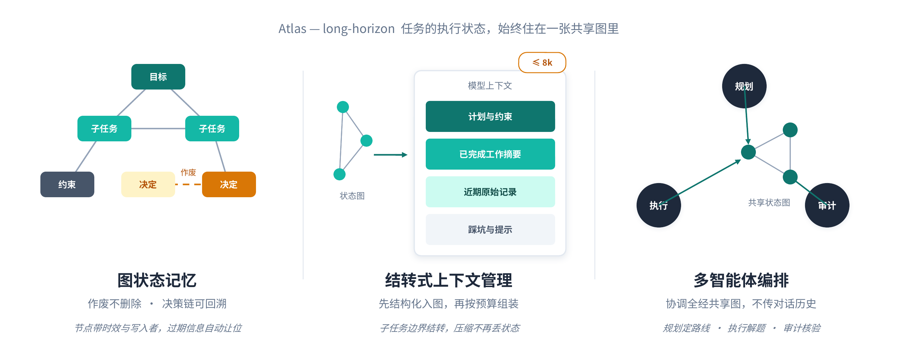

# Atlas Research Agent

<p align="center">
  
</p>

   

**面向长程研究任务的可恢复多智能体运行时（Atlas）+ 自适应检索决策引擎（CompassRAG）。**

> Long-horizon agents forget. Text compression drops structure and exact values; semantic retrieval fragments decision chains. Atlas keeps execution state in a time-aware graph, carries it over into the model context, and lets multiple roles coordinate through that single shared graph. For each research subtask, CompassRAG decides *whether, how, and how long* to retrieve — and returns evidence with traceable provenance.

这个仓库把两层合成一个项目：

| 层 | 目录 | 单一职责 | 不负责 |
|---|---|---|---|
| **Atlas 运行时** | `atlas/` | 长程任务、子任务依赖、共享状态图、角色协作、上下文结转、暂停/恢复、总任务 trace | 检索实现、单次研究问题的检索决策 |
| **CompassRAG 检索层** | `compassrag/` | 单次研究请求内的问题路由、多跳检索、查询改写、实体图检索、证据充分度、claim 核验、有限修复与拒答 | 跨子任务长期状态、任务生命周期 |
| **ResearchTool 协议** | `atlas/tools/` | 请求/响应/失败分类/幂等键/trace 关联；隔离进程内与 HTTP 两种调用 | 承载任一方的业务状态 |

```
用户 / Web 工作台 / CLI
        │
        ▼
Atlas API（FastAPI）── AgentRuntime ── Repository（任务 / 图 / 事件 / checkpoint / trace）
        │
        ▼
Orchestrator（LangGraph 只表达控制流）
  Planner → Research → Worker → Auditor → Repair / Finish
                 │
                 ▼
        ResearchTool 协议（进程内 CompassRAGAgentTool / HTTP CompassRAG 服务）
                 │
                 ▼
        CompassRAG Agent：路由 → 计划 → 检索（BM25 / 稠密 / 实体图）→ 证据核验 → 答案
                 │
                 ▼
    证据 + 置信度 + 停止原因 + trace_id 回到 Atlas，写成带 provenance 的 Fact
```

**边界**：Atlas 只通过 `ResearchTool` 调 CompassRAG；CompassRAG 不反向读写 Atlas 的库。Atlas 保存被选用的结论、来源引用与 CompassRAG 的 `trace_id`，不复制其内部索引与轨迹。业务状态的唯一真源是 Atlas repository，框架 checkpoint 不作第二真源。

## 合并后新增的能力

- **真实进程内桥接**：`atlas/tools/compassrag.py` 的 `CompassRAGAgentTool` 直接驱动同仓 CompassRAG Agent，不需要先起 HTTP 服务；请求/证据/失败/trace 做确定性映射，`failure` 归一到 Atlas 五类错误。
- **证据可追溯**：证据项带 `retriever` / `rank`；Atlas 的 OrchestrationTrace 记录 CompassRAG 自己的 `trace_id`，一条命令即可从总任务下钻到单次检索轨迹。
- **一条命令看闭环**：`examples/atlas_compassrag_demo.py` 用真实代码路径（真 Orchestrator + 真 CompassRAG Agent + SQLite 仓库）跑完「规划 → 取证 → 证据入图 → 核验 → 失败路径」，全程离线、零密钥。
- **一套环境/一套测试**：一个 `pyproject.toml` 装两个包，`pytest` 一次跑完 569 项（6 项文档一致性检查在无 `runs/qa` 时跳过）。

## 快速开始

```bash
# 1) 环境（Python ≥ 3.10）
python -m venv .venv && source .venv/bin/activate
pip install -e ".[dev,api]"        # 需要稠密检索再装 ".[dense]"；演示页装 ".[demo]"

# 2) 30 秒看两层闭环（离线、无密钥）
python examples/atlas_compassrag_demo.py

# 3) 看 Atlas 运行时：建任务 → 推进 → 暂停 → 换连接恢复 → 回放
python examples/quickstart.py

# 4) 看 Atlas 编排链路：规划 → 研究工具取证据 → 执行 → 核验打回 → 修订 → 恢复
python examples/research_agent.py

# 5) 图状态记忆演示（脚本化提取器，零 API 凭据）
python -m atlas.demo                          # 产物：runs/demo/graph.html / graph.svg
streamlit run atlas/demo_app.py               # 交互式观察结转过程（需 ".[demo]"）

# 6) 端到端任务级评测（离线脚手架，只验证机制）
python scripts/run_merged_e2e.py

# 7) 统一入口：Atlas 任务 API + 只读工作台页（/atlas）
python scripts/serve_atlas_api.py --demo --port 8001   # 另开终端：建演示任务并起 API
cd web && npm ci && npm run dev                        # 浏览器打开 http://localhost:5173/atlas

# 8) 静态任务报告（HTML：状态 / 角色步骤 / 证据 / CompassRAG trace）
python -m atlas.cli report <session_id> --db <SQLite 路径> \
    --research-base-url http://127.0.0.1:8000

# 9) 全部测试
pytest -q                      # 后端 573 项
cd web && npm test             # 前端 14 项
```

CompassRAG 的检索侧可以单独使用与评测（真实索引需要先按 [docs/compassrag/README.md](docs/compassrag/README.md) 构建语料/索引，并配置 `.env`）：

```bash
cp .env.example .env                       # LLM_BASE_URL / LLM_API_KEY / LLM_MODEL
python scripts/serve_api.py --config configs/ablation/plus_full_words.yaml --check
python scripts/eval_retrieval.py --benchmarks musique --variant samples --modes hybrid,kg,hybrid_kg
bash scripts/demo.sh                       # 一条命令起 FastAPI + Vite 工作台（需 npm 依赖与索引）
```

## 评测与口径

- **Atlas 运行时**：MemoryArena `formal_reasoning_math` 官方 runner 不改动，A/B 只差一行 config；另有「三类长程 fixture × 三种记忆策略 + 五类故障注入 + replay」的离线评测。口径与复现命令见 [docs/evaluation.md](docs/evaluation.md)，环境说明见 [eval/README.md](eval/README.md)。
- **CompassRAG 检索层**：MuSiQue 同题集消融阶梯（naive → 改写 → 实体图 → 决策层 → 全家桶 → 证据核验），指标、样本量与已知局限见 [docs/compassrag/README.md](docs/compassrag/README.md) 与 [docs/compassrag/evaluation.md](docs/compassrag/evaluation.md)。
- **合并链路（离线）**：`integration/merged_e2e.py` 五类任务场景，验证的是「编排→检索→证据入图→修订/失败隔离→恢复」是否闭合与判分是否有效，**不是效果数字**；真实端到端数字仍需真实模型 + 固定题集/索引 + 重复。
- **口径纪律**：离线脚手架结果只验证指标，真实模型结果才可作为效果数字；小样本只作演示，不写成普适结论。两层各自报告数字，不把检索层收益合并成端到端提升。

## 项目结构

```
atlas/
├── atlas/                 # 运行时层
│   ├── memory/            #   图引擎：六类节点 / 五类边 / status 生命周期 / JSONL 持久化
│   ├── context/           #   LLM 结转提取器 + 四区组装器 + 规则查账 + 结转触发
│   ├── orchestration/     #   三段式编排 + 状态机 + 角色策略（LangGraph 只表达控制流）
│   ├── runtime.py         #   对外门面：任务生命周期 / 恢复 / 回放
│   ├── storage/           #   SQLAlchemy 仓储 + 不可变事件 + checkpoint
│   ├── tools/             #   ResearchTool 协议 + CompassRAG 进程内/HTTP 适配器
│   ├── api/               #   FastAPI 薄壳（任务 API）
│   ├── observability/     #   结构化 trace
│   ├── evaluation/        #   三 fixture × 三策略 + 故障注入 + replay
│   └── demo.py / export.py / cli.py / report.py
├── compassrag/            # 检索层
│   ├── agent/             #   契约 / 统一工具协议 / 控制流（顺序实现 + LangGraph）
│   ├── decision/          #   路由、计划、证据充分度早停
│   ├── retrieval/         #   BM25 / BGE-M3 稠密 / RRF 融合
│   ├── index/             #   实体关系图（PPR）+ wiki 摘要索引（负结果留档）
│   ├── diagnose/          #   claim 核验 + 五类失败与有限修复
│   ├── api/               #   Research API（同步 / 异步 / SSE / 取消）
│   ├── adapters/          #   Atlas 本地与 HTTP adapter（同一 ResearchTool 协议）
│   └── eval/              #   trace / manifest / 指标 / 断点续跑
├── examples/              # 合并闭环 / quickstart / research_agent
├── integration/           # 跨层脚手架：任务级离线评测（不进任一方的包）
├── scripts/               # Atlas 评测入口 + CompassRAG 语料/索引/评测/服务脚本
├── configs/               # CompassRAG 模型端点与消融开关
├── data/samples/          # 三基准分层抽样清单（seed=42，入仓可复现）
├── web/                   # 工作台：/ 研究（CompassRAG）+ /atlas 任务（Atlas，只读）
├── eval/                  # MemoryArena 评测脚手架（memory server / configs）
├── tests/                 # 两层的单元测试（569 项，无需真实 API；含 HTTP 重启用例）
└── docs/                  # Atlas 文档 + compassrag/ 检索层文档 + 架构图
```

## 合并说明

本仓库由两个独立项目合并而来：Atlas（`dundundun0116/atlas`）与 CompassRAG（`dundundun0116/compassrag`，合并时基线 `cd20f02` + 未提交工作树）。合并方式是**单仓双层、边界不变**：两包并列、协议仍走 `ResearchTool`，不把检索实现复制进 Atlas，也不让 CompassRAG 变成 Atlas 的内部子包。原 CompassRAG 仓库保留为归档；内部台账/计划/面试材料不进入公开树（见 `.gitignore` 的 `docs/internal/`）。

系统设计、端到端流程、契约与集成验收见 [docs/ATLAS_COMPASSRAG_SYSTEM_DESIGN.md](docs/ATLAS_COMPASSRAG_SYSTEM_DESIGN.md)。

## Roadmap

- [x] 可恢复运行时：持久化 / 事件 / checkpoint / 幂等 / 任务 API / trace / replay
- [x] ResearchTool 协议 + CompassRAG 进程内真实桥接 + 证据 provenance / trace 关联
- [x] 单仓合并：一套依赖、一套测试、一份文档入口
- [ ] 真实模型端到端评测（固定任务集、预算、重复次数）——效果数字的前提
- [ ] 角色消融（Planner / Worker / Auditor 各自贡献拆分）
- [x] 统一任务报告（静态 HTML：状态 / 角色 / 证据 / CompassRAG trace 下钻）
- [x] 统一工作台：Vite `/atlas` 只读页（任务状态 / 角色步骤 / 图节点 / 报告）

## License

[MIT](LICENSE)
